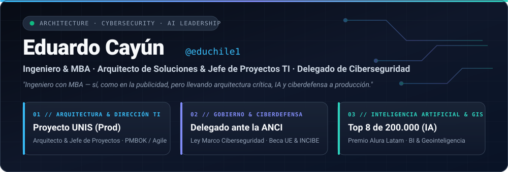
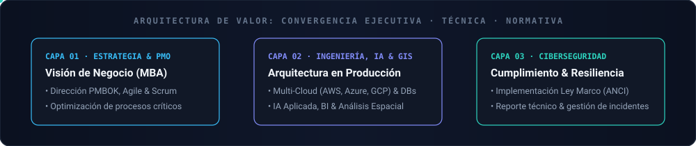

<div align="center">
  
</div>

<br/>

<div align="center">
  
</div>

<br/>

## ⚡ Manifiesto Ejecutivo

> Traduzco desafíos complejos de negocio en **arquitecturas tecnológicas seguras, escalables y medibles**. Mi diferencial está en hablar con la misma fluidez el idioma del directorio (**MBA & PMO**), el del equipo de ingeniería (**Arquitectura, Cloud, Datos e IA**) y el del regulador (**Ley Marco de Ciberseguridad & ANCI**).

```yaml
# system-manifest: eduardo-cayun.arch.yaml
identidad:
  nombre: "Eduardo Cayún (@educhile1)"
  formacion_base: ["Ingeniero", "Master of Business Administration (MBA)"]
  propuesta_de_valor: "Transformación digital, arquitectura en producción y ciberdefensa normativa"

operacion_actual_en_produccion:
  proyecto_insignia:
    nombre: "Proyecto UNIS"
    rol: "Arquitecto de Soluciones & Jefe de Proyectos"
    metodologias: ["PMBOK", "Scrum", "Agile"]
  gobierno_ciberseguridad:
    rol: "Delegado de Ciberseguridad"
    marco_regulatorio: "Ley Marco de Ciberseguridad (Chile)"
    contraparte_oficial: "Agencia Nacional de Ciberseguridad (ANCI)"

modo_off_production:
  deportes: ["Tenis 🎾", "Fútbol ⚽"]
  estrategia_y_ocio: ["Videojuegos 🎮"]
```

---

## 🏆 Hitos, Becas Internacionales y Especialización

| Distinción / Programa | Institución / Alianza | Impacto y Enfoque |
| :--- | :--- | :--- |
| 🥇 **Top 8 entre 200.000 proyectos (Top 0.004%)** | **Alura Latam IA** | Reconocimiento regional por desarrollo e innovación aplicada con Inteligencia Artificial. |
| 🇪🇺 **Beca Internacional en Ciberseguridad** | **Universidad de Málaga · Unión Europea & INCIBE** | Especialización avanzada en ciberdefensa, seguridad de la información y resiliencia operativa. |
| ☁️ **Beca Oracle Next Education (ONE G9)** | **Oracle** | Especialización en arquitectura de software, backend y cloud en el nivel **Tech Advanced**. |
| 🔐 **Becas Santander Cybersecurity & Skills for Work** | **Banco Santander** | Formación ejecutiva en gobierno de seguridad digital y competencias tecnológicas de alto impacto. |

---

## 🛠️ Ecosistema Tecnológico y Herramientas

| Dominio | Tecnologías, Marcos y Herramientas |
| :--- | :--- |
| **Gobierno TI & Dirección** |    -0f172a?style=flat-square&logo=letsencrypt&logoColor=2dd4bf) |
| **Lenguajes & Desarrollo** |        |
| **Datos & Motores DB** |     |
| **Cloud, BI & Geointeligencia** |    -0f172a?style=flat-square&logo=powerbi&logoColor=2dd4bf)  |

---

<div align="center">

### 📫 Contacto Directo

Abierto a liderar iniciativas estratégicas de transformación digital, arquitectura de sistemas, ciberseguridad normativa y colaboraciones tecnológicas de alto impacto.

<a href="mailto:eduardocayun@gmail.com">
  
</a>

</div>
